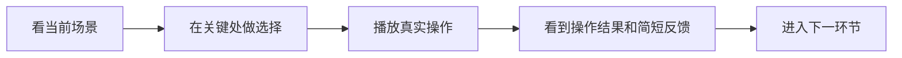

# 冰美式 Demo 玩法与剪辑候选清单

状态：讨论稿，尚未确定最终玩法与切点

素材：10 分钟第一人称原片；时间均为**原片约略时间**，不是已校准的剪辑入点和出点。

## 体验主线

先做一条正确流程。视频承担“看到怎么做”，互动承担“主动想起下一步”；不需要每个动作都停下来答题。

## 按原片列出的候选片段

| 单元 | 原片约略时间 | 保留的画面与声音 | 剪辑处理 | 候选互动 |
| --- | --- | --- | --- | --- |
| 1. 洗手 | 02:00–02:13 | 流水洗手、取灰布擦手 | 教学顺序若按参考流程，需要移到开头；重排后的衔接另做 | 开始前先做什么？选择洗手 |
| 2. 备杯和器具 | 00:18–01:59 | 取直筒杯、吸管、量杯和吧勺；冲洗、擦干 | 按“取物→清洗→擦干→放好”归并；重复取放和扫镜头可缩短 | 选择下一件要准备的器具；这一段可只设 1 次互动 |
| 3. 冰和水 | 02:14–02:59 | 取冰、加水，保留冰进入杯中和水位变化 | 多次取冰压缩为一次连贯过程，保留最终杯内状态 | 排顺序：先加冰，再加水 |
| 4. 咖啡粉准备 | 03:00–05:12 前段 | 清洁粉碗、接粉、称重、调整粉量；保留相关原声 | 去掉重复等待，保留至少一次“读数→调整→再看”的因果过程 | 看到粉量未到目标时，选择“调整后再确认” |
| 5. 布粉与压粉 | 03:00–05:12 后段 | 布粉器旋转、压粉、清理粉碗边缘 | 一组连续动作播放，避免在压粉动作中间切开 | 可作为纯观看段，不强加答题 |
| 6. 萃取准备与萃取 | 05:12–06:40 | 冲煮头空排、擦沥水盘、量杯去皮、挂手柄、启动及停止萃取 | 准备步骤保留顺序；萃取等待可压缩，但保留液体开始流出和结束状态 | 启动前选择“先把量杯和秤准备好”；停止时机可用原声提示，不依赖看清秤面数字 |
| 7. 混合与出品摆盘 | 06:40–07:29 | 浓缩液倒入冰水、搅拌、杯上托盘、配吸管和纸巾 | 保留咖啡在冰水中扩散的可见变化；重复调整摆放可缩短 | 选择下一步：倒入浓缩液、搅拌；摆盘可做拖放 |
| 8. 服务与清洁 | 07:30–10:00 | 服务原声；手柄、器具和台面清洁 | 服务话术单独成段；清洁动作归并；原片结束没有完整归位镜头 | 选择一句对客介绍；清洁可做最后的“还有什么要收拾” |

**建议先试做的 3 个互动：** 冰与水的顺序、粉量调整、倒入浓缩液后的下一步。它们分别对应顺序、判断和结果变化，能先验证“看片—选择—看片”的节奏。其余互动是备选，不代表都要放进 Demo。

## 剪辑时要处理的三处素材问题

1. **洗手顺序：** 原片先准备器具，约 02:00 才洗手；参考流程要求先洗手。若按参考流程重排，需检查洗手镜头接到备杯镜头是否突兀，必要时加简短过场或补拍。
2. **服务画面：** 原声有问候与饮品介绍，但没有清楚拍到客人、微笑或递杯。可以用托盘静帧配台词选择；不要把这些动作标成原片已拍到。成品液面检查也缺清晰特写。
3. **清洁结尾：** 原片结束时仍在拿电子秤，没有清楚拍到归位。可以在已有最后可用画面收束，完整归位需要补拍。

## 切点规则

每个可播放片段尽量包含“操作前状态 → 关键动作 → 看得见的结果”。优先在手和器具相对稳定时切，避免从倒水、压粉或萃取动作中间截断。现有 `final.reviewed.json` 适合定位素材；它的画面分析按每秒 1 帧采样，实际切点还需回原片逐帧确认。声音也要同步检查，避免一句话被切成两半。

参考：[原片时间线复核](./video-review-2026-11-20.md)、[v0.1 Demo 讨论记录](./v0.1-demo-spec.md)。
