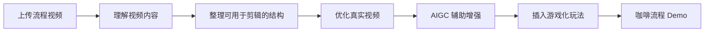
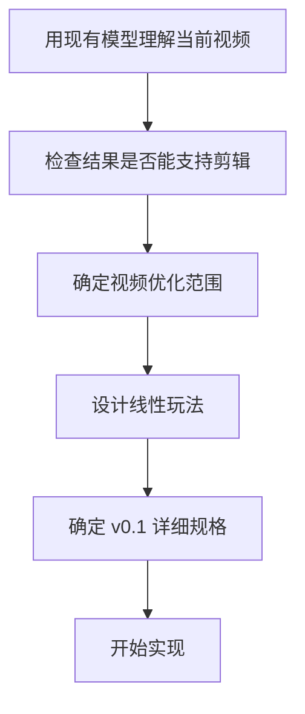

# CoffeeGame v0.1 Demo

状态：讨论记录

更新：2026-11-13

## 已确认的方向

- 当前只做咖啡流程 Demo。
- 输入是一段完整、正确的第一人称流程视频；当前已有冰美式视频和参考流程。
- 产品首先是一个好用的创作工具，不追求完全自主生成。
- 系统理解视频后，要方便继续剪辑、优化画面和插入玩法。
- 第一版先做好正确流程的线性体验，再考虑支线。
- 操作评测是另一项工作，不属于当前范围。
- 通用模块和跨项目复用以后再考虑。

## 当前工作流

## v0.1 需要解决的问题

### 1. 视频理解

- 理解视频中发生了什么。
- 梳理主要阶段和连续操作过程。
- 保留动作前后文，不能机械地把连贯动作切碎。
- 生成方便后续剪辑和插入玩法的结果。
- 可以参考现有流程表，但不做正确性评测。

### 2. 视频优化

- 处理镜头偏移、抖动和其他影响观看的问题。
- 优化画面帧和整体观感。
- 保留真实操作，不因优化改变关键过程。

### 3. AIGC 增强

- 研究 AIGC 能在哪些位置改善或补充视频。
- 关键真实操作与生成内容需要明确区分。

### 4. 游戏化

- 将正确流程做成清楚、有趣的线性体验。
- 玩法插入不能破坏视频和动作的连贯性。
- 支线是否需要、怎样设计，放到线性 Demo 完成后再讨论。

## 当前素材

- `source/冰美式第一人称视频.MP4`
- 冰美式参考流程：8 个阶段、33 个步骤、61 个动作。

## 尚未决定

- 使用哪个视频理解模型或服务。
- 视频理解结果的最终数据格式和编辑界面。
- v0.1 包含哪些具体玩法、多少个互动点。
- AIGC 具体生成什么内容。
- Demo 的视觉风格和角色设计。
- 目标年龄、优先设备和发布形式。
- 视频优化的具体工具与自动化程度。
- v0.1 的详细验收指标。

## 下一步

